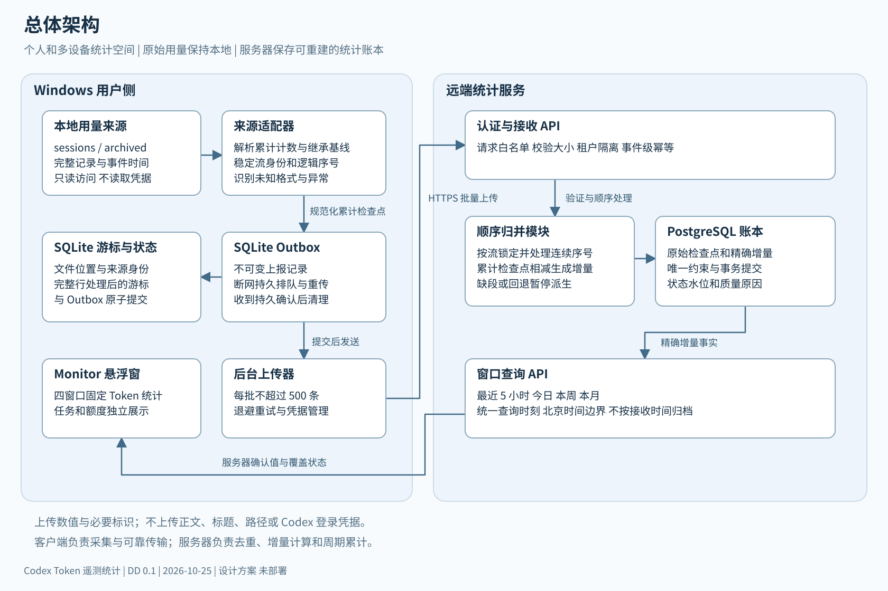
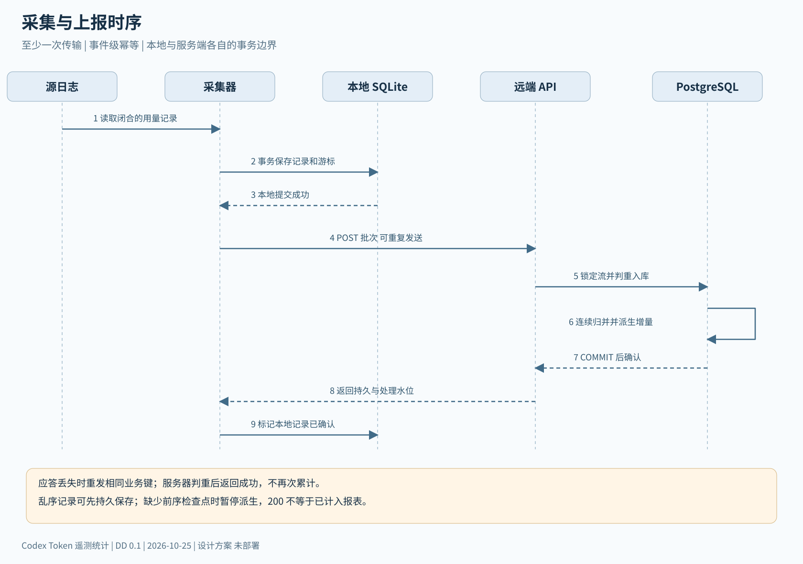
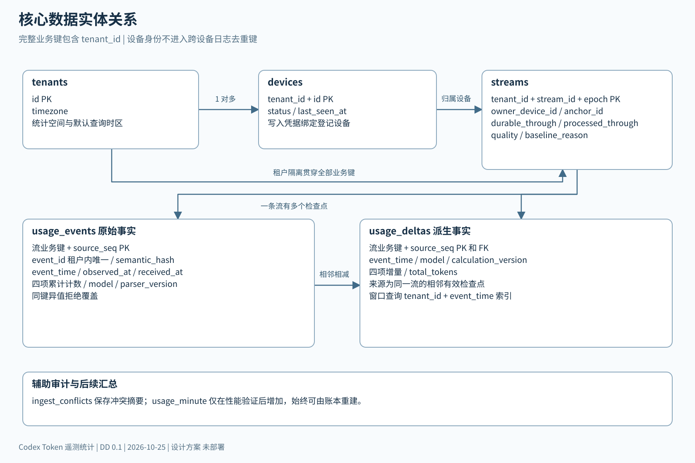
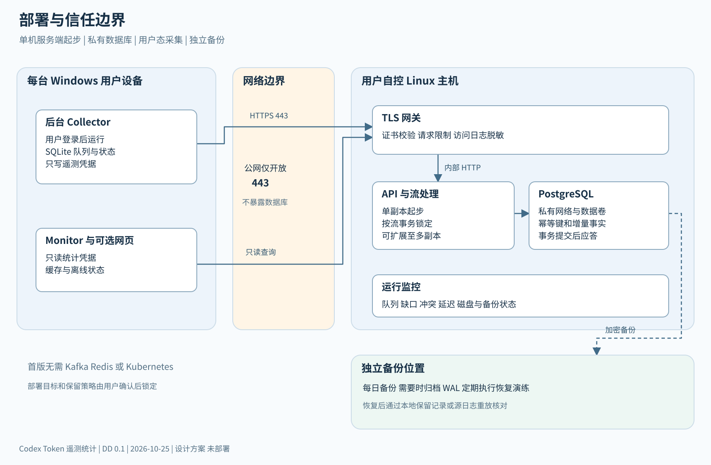

# Codex Token 遥测统计详细设计

版本 0.1　｜　日期 2026 年 10 月 25 日　｜　状态 供架构评审和实施拆分

本文定义 Windows 用量采集器、远端统计服务与 Codex Monitor 悬浮窗的协作方式。目标是在多个接入设备之间汇总 Token，持续显示最近 5 小时、今日、本周和本月用量，并支持断网补传、历史导入、重复记录去重和数据质量提示。

结论：方案可行。推荐上传带原始发生时间的累计检查点，由服务器按逻辑数据流计算增量并形成统计账本。必须保留事件明细和稳定来源身份，不能把每次上报的累计值直接相加。本文件是设计交付，未修改已安装程序，未部署服务，未开启遥测或发送用户用量。

## 1 文档范围与阅读方式

本方案的 DD 指 Detailed Design，即详细设计。面向客户端、服务端、测试和运维实施人员。正文规定统计语义与一致性要求；附带的 OpenAPI 和 PostgreSQL DDL 是相互对应的 v0.1 核心接口与数据库草案，尚未经过真实服务器集成验证。

交付目录包含 DD.md、可离线浏览的 DD.html、四张架构图及 Mermaid 源文件、openapi.json 和 schema.sql。HTML 内嵌样式与图，不依赖外部 CDN。架构图中的时间、容量和部署规格均为建议目标，不是已完成的性能测试结果。

## 2 背景与现状证据

现有安装为 Yxianshe/Codex-Monitor v2.1.4。源码 MainWindow.axaml.cs 使用 5 秒数据刷新间隔，额度查询另有约 30 秒间隔；Token 显示超过百万后使用一位小数的 M 单位。MonitorData.cs 从本地 threads 表读取 tokens_used，只查询最近更新的 12 个未归档线程，之后过滤活跃任务。因此现有任务列表不具备完整历史采集能力，额度百分比也不是周期 Token 账本。[S1][S2]

本地日志可包含 token_count 累计量和请求增量，也可能包含子代理继承的父会话前缀，以及未计入常规累计量的压缩用量。保留的日志能够支持历史重建，但缺失记录不能凭空恢复，适配器必须识别不同日志版本。[S3]

## 3 目标与边界

| 编号 | 目标 | 验收定义 |
|---|---|---|
| G01 | 四个固定时间窗口 | 同一查询时刻返回最近 5 小时、今日、本周、本月 |
| G02 | 多设备汇总 | 接入同一统计空间的设备用量可合并并按来源筛选 |
| G03 | 重传不重复计数 | 同一事件上传 100 次只产生一份账本增量 |
| G04 | 断网与进程重启恢复 | 已落入本地队列的记录能够在重连后续传 |
| G05 | 可解释与可重建 | 任一汇总值可追溯到去重后的用量增量 |
| G06 | 最小上传字段 | 不上传对话正文、任务标题、文件路径和 Codex 登录凭据 |
| G07 | 暴露完整性 | 缺段、未知基线、时钟异常、解析不支持均能显示 |

不包含：向模型请求插入代理、修改 Codex 网络通信、推算官方账号额度、订阅账单结算、采集未接入设备，以及准确重建已删除且从未采集的历史。

服务接受客户端报告，不是防篡改计费凭据。HTTPS 和设备凭据能够限制谁可以上报，不能证明客户端上报的 Token 必然真实。若将来用于财务结算，应改接可信服务端调用记录或供应商账单来源。

## 4 核心设计决策

| 决策 | 采用方案 | 依据与代价 |
|---|---|---|
| ADR01 | 独立用户态采集器 | 关闭悬浮窗后仍可采集，避免 UI 生命周期造成漏记 |
| ADR02 | 累计检查点作为核心上传记录 | 服务端统一计算增量，便于审计和重放；必须处理顺序和基线 |
| ADR03 | 事件时间归属 | 断网补传不会把昨天用量记到今天 |
| ADR04 | 至少一次传输 加服务端幂等 | 网络重试允许重复，数据库保证一条增量只生效一次 |
| ADR05 | PostgreSQL 作为统计事实库 | 原始检查点、派生增量、状态可在同一事务中提交 |
| ADR06 | v0.1 查询精确增量表 | 先保证正确性；性能需要时再加入可重建的分钟汇总 |
| ADR07 | 遥测可独立停用 | 保留原悬浮窗的本地任务与额度功能 |
| ADR08 | 未识别用量显式标为部分覆盖 | 对压缩补充记录等未验证格式不猜测、不静默归零 |

OpenTelemetry 支持累计与增量两种指标语义，也明确讨论重置、缺段和多个写入者的问题。可将本系统运行指标接入 OTel，但不能用普通指标导出替代此处的事件账本。[S4][S5]

## 5 总体架构



Windows 用户侧由 Source Discovery、Source Adapter、Cursor Store、Outbox Uploader 和 Local Status 五个模块组成。服务器侧采用一个可横向扩展的 API 进程，内部划分写入、顺序归并、查询和管理模块；首版不依赖消息队列、Redis 或专用时序数据库。

每个 Windows 用户可配置多个 Codex 数据目录。采集器与 Codex 以同一用户身份运行，只读数据目录；不以 LocalSystem 身份递归扫描全部用户。建议通过用户登录触发的后台程序启动，悬浮窗单独运行。服务器与客户端独立升级。

主路径为：本地日志 → 规范化累计检查点 → SQLite 持久队列 → HTTPS 批量接口 → PostgreSQL 去重账本 → 时间窗口查询 → 悬浮窗。任务标题只留在本机，远端数据用匿名流标识关联；UI 可以在本机完成标题映射。

## 6 组件职责与技术选择

| 组件 | 职责 | 建议实现 |
|---|---|---|
| Windows Collector | 发现文件、尾读、规范化、持久游标、补传 | .NET 10 Worker，自包含 Windows x64 发布 |
| Local Store | 原子保存游标与待发送记录 | SQLite，用户目录 ACL，仅当前用户可写 |
| Monitor Integration | 固定统计区、最后同步时间、完整性状态 | 现有 Avalonia UI 增加服务端查询模块 |
| Ingest API | 认证、配额限制、字段验证、去重入库 | ASP.NET Core 10 |
| Stream Processor | 顺序处理检查点，计算和写入增量 | 首版与 API 同进程，数据库事务内执行 |
| Query API | 四窗口汇总、设备健康和过滤 | 同一 API，独立读取权限 |
| Database | 原始记录、增量事实、接入设备、状态 | PostgreSQL 18，补丁版本实施时锁定 |
| TLS Gateway | TLS 终止、请求体与速率限制 | 已有网关优先，无现有网关时选择轻量反向代理 |

.NET 10 是当前受支持 LTS；现有程序依赖的 .NET 8 临近 2026 年 11 月 10 日支持结束。新采集器和服务端采用 .NET 10，现有 UI 的运行时升级另列兼容性工作，不能只替换运行时而不验证 Avalonia 依赖。[S6]

## 7 统计定义

### 7.1 Token 组成

input_tokens 表示输入量，包含 cached_input_tokens；output_tokens 表示输出量，包含 reasoning_output_tokens。核心关系为：

```text
total_tokens = input_tokens + output_tokens
uncached_input_tokens = input_tokens - cached_input_tokens
cached_input_tokens <= input_tokens
reasoning_output_tokens <= output_tokens
```

缓存输入和推理输出可以独立展示，但不能再次加到总量。缺少子项时保留 unknown，不以猜测的零替代；v0.1 核心 API 要求四项齐备，适配器遇到不齐备的格式进入待适配队列，而不是上传伪造数据。显示累计量可切换完整整数和缩写；缩写仅影响显示。

### 7.2 时间窗口

服务器保存 UTC，查询使用 IANA 时区 Asia/Shanghai；整份响应使用一个数据库查询时刻 as_of。区间统一左闭右开，即 start <= occurred_at < end。

| 名称 | 开始时间 | 结束时间 |
|---|---|---|
| rolling_5h | as_of 减 5 小时 | as_of |
| today | as_of 所在北京时间日期 00:00 | as_of |
| week | 本周一北京时间 00:00 | as_of |
| month | 本月 1 日北京时间 00:00 | as_of |

本周不是最近 7 天，本月不是最近 30 天。若以后支持滚动 24 小时、7 天、30 天，应使用独立窗口名称。账号配额 5 小时窗口另行展示，不把 rolling_5h 标成官方配额窗口。

### 7.3 时间精度与模型归属

增量归属到后一个用量检查点的日志发生时间。长请求跨午夜但日志只在结束时写入时，整段量记入结束时点；无法恢复生成过程中每个 Token 的真实时刻。模型取该用量记录对应的已确认上下文；模型切换区间不明时归为 unknown，不把混合用量猜给当前模型。

保留 event_time、observed_at 和 received_at 三种时间。event_time 用于窗口，observed_at 用于采集延迟，received_at 用于传输延迟。事件时间超过服务器当前时间 5 分钟的记录可持久保存但暂不计入，标记 clock_anomaly；历史导入允许旧时间，不使用统一的过期丢弃策略。

服务端入库前将事件时间统一到 UTC 毫秒精度，与语义哈希采用同一规范。一个流内事件时间逆序时保留源逻辑顺序，并标记时钟异常；在确认归属前暂停对应增量，不能用接收时间覆盖原时间来消除异常。

## 8 来源身份与稳定事件编号

### 8.1 标识层次

tenant_id 为服务端统计空间，由认证凭据决定，不信任请求中的任意 tenant_id。device_id 是一次设备注册身份，只用于认证、健康和来源说明，不进入跨设备日志去重的业务主键。

stream_id 是逻辑会话数据流的租户内匿名标识，推荐由共享的租户匿名化密钥对原始会话 UUID 和来源命名空间进行 HMAC SHA256。该密钥与上传凭据分开管理；同一日志在不同设备复制后仍得到同一 stream_id。若密钥轮换，需维护标识映射；不能直接换键导致整份历史变成新流。

epoch 为计数器世代。只有存在明确的源日志重置证据才能开启新 epoch；程序重启、重装和网络重连均不能自动增加 epoch。无法解释的计数回退应阻塞该流并标记异常。

source_seq 为规范化用量检查点在该 epoch 内的逻辑序号：基线为 0，之后从 1 连续递增。它由完整、可验证的逻辑日志顺序以及该流唯一的采集起点确定，不是文件字节偏移、系统时间、上传次数或随机 UUID。归档、压缩和完整文件复制不能改变该序号。

每条流的 owner_device 首先登记不可变的 anchor_id，指向已选择的源基线位置。其他设备开始采集同一流前，必须读取服务端流状态并采用相同 anchor_id、基线和编号规则；不能把自己首次看到的累计值重新设为 seq 0。默认从现在开始时，anchor_id 指向首次捕获检查点；完整历史导入时，它指向可证明的会话或子会话起点。从现在开始的流以后若需追加更早历史，应创建替代账本版本并重建，不能直接向同一基线之前塞入历史量。

```text
业务唯一键 = tenant_id + stream_id + epoch + source_seq
event_id = HMAC(identity_key, stream_id + epoch + source_seq)
canonical_hash = SHA256(按协议规范化后的语义字段)
```

相同业务键和相同 canonical_hash 表示重传。相同业务键但内容不同表示冲突，返回 409 并停止自动累计；不能使用最后写入覆盖。observed_at、设备身份和上传批次等传输字段不参与 canonical_hash，避免跨设备读取时间不同造成伪冲突。

哈希输入按固定顺序的 JSON 数组序列化为 UTF8，字段包含协议版本、stream_id、epoch、anchor_id、source_seq、kind、UTC 事件时间、model、四项累计值和基线原因。计数使用无前导零的十进制字符串，时间统一为 UTC 毫秒精度，不能拼接无边界字符串。服务端重算语义哈希；不信任客户端提供的哈希。parser_version 用于审计，兼容解析器不得改变语义哈希输入。

### 8.2 复制与分叉限制

相同完整日志由多个设备上报可去重，但设备维度只展示该流的指定归属设备，不能给每个副本各记一次。归属采用首次有效注册的 owner_device_id，并可通过显式迁移修改。

若同一会话 UUID 的两个副本发生不同的后续写入，不能假设仍是同一条流；冲突会阻塞并要求适配器验证分叉身份。只有截断后缀、无法确定逻辑序号的日志进入 unknown_identity 状态，不承诺自动跨设备去重。多代理子会话的父历史回放作为继承基线，不作为子会话新增用量。[S3]

## 9 本地采集与历史导入

### 9.1 文件发现和尾读

扫描显式配置的数据根目录，同时发现 sessions 和 archived_sessions。首版优先实现普通 JSONL，压缩日志通过独立适配器解压读取；同一逻辑日志的普通版与压缩版只选一个来源。监听文件事件用于降低延迟，另每 60 秒进行恢复扫描，不能依赖事件通知保证完整性。

尾读仅处理换行闭合的 JSON 记录。写到一半的尾行留到下次，解析错误记录计入健康状态；不读取认证文件，不向诊断日志打印整行原文。发现文件缩短或内容身份变化时，重新索引并通过业务键去重，不能从新偏移直接接着累计。

### 9.2 游标与队列事务

本地 SQLite 至少包含 file_cursors、source_streams、outbox 和 collector_health。对一批完整解析记录，在同一事务内写入 outbox 并更新 file_cursors。事务提交后才认为记录已采集。崩溃后可以重读，重复由稳定业务键消除。

建议采集检查间隔 5 秒、上报批次最多 500 条且解压后不超过 512 KiB；未达到批次阈值时最多等待 10 秒。只在存在待上传记录时上报用量，健康心跳默认 60 秒一次，不用重复累计检查点充当心跳。

### 9.3 初始基线和历史导入

首次启用提供两种独立模式：从现在开始，或导入指定日期以后的本地历史。默认从现在开始，以首次有效累计值作为基线且不计量；后续只累计变化。历史导入只有在完整日志能够证明源起点时，才允许建立零基线并逐条重建。

如果第一条可见记录已经累计 200 万，但之前的事件时间已丢失，这 200 万属于 unallocated_history，不能全记到启用当天。界面显示“存在无法分配到时间窗口的历史量”。首次上报基线不能等同于首次发生用量。

### 9.4 子代理 压缩与格式变化

适配器需要识别继承前缀，使用最后一条已确认的继承检查点作为子会话基线，之后只发送子会话自己的检查点。遇到无法验证的继承关系，保留待处理来源并使覆盖状态为 partial。

远端压缩可能产生额外用量记录，且不一定改变常规累计量。v0.1 核心协议仅覆盖经验证的常规累计检查点；发现额外压缩用量标记 unsupported_usage，不能宣称所有用量完整。后续 v0.2 增加有独立响应身份和覆盖证据的补充用量账本，验证未被常规检查点覆盖后再计入。原始日志仍在本机，不向服务器上传正文以排查。

## 10 上报接口与应答语义



核心接口由附件 openapi.json 定义。所有上传和查询都通过 HTTPS；写入凭据与读取凭据分开。接口版本放在 /v1 路径中，每条记录还包含 schema_version 和 parser_version。

| 接口 | 方法 | 用途 |
|---|---|---|
| /v1/usage/batches | POST | 原子接收一批累计检查点 |
| /v1/usage/summary | GET | 返回四个固定时间窗口 |
| /v1/devices/status | GET | 返回设备同步状态和队列健康 |
| /v1/devices/heartbeat | POST | 更新采集覆盖状态 队列长度和扫描时间 |
| /v1/streams/{stream_id}/state | GET | 读取匿名流基线 锚点和持久及处理水位 |
| /health/live | GET | 进程存活探测，不返回用户统计 |

v0.1 批次只包含同一 stream_id 和 epoch，最多 500 条；有利于用单条流锁保证顺序和原子性。collector_instance_id 和设备身份由设备注册或认证上下文提供。Token 值在 JSON 中编码为十进制字符串，服务端按非负 int64 校验，防止 JavaScript 大整数精度丢失。

首次建立流时必须由指定 owner_device 提交包含 seq 0 的基线批次，服务端同时固定 anchor_id 和 baseline_reason。已有流的后续批次可不带基线。健康心跳每 60 秒上报队列数量、最老待传时间、最后成功扫描时间及白名单质量原因；心跳失败后下次发送当前状态，不持久重放过时心跳，不上传日志原文。

```json
{
  "schema_version": "1.0",
  "parser_version": "codex-checkpoint-1",
  "batch_id": "01JDESIGNEXAMPLE",
  "stream_id": "aaaaaaaaaaaaaaaaaaaaaaaaaaaaaaaaaaaaaaaaaaaaaaaaaaaaaaaaaaaaaaaa",
  "epoch": 0,
  "anchor_id": "cccccccccccccccccccccccccccccccccccccccccccccccccccccccccccccccc",
  "records": [
    {
      "event_id": "bbbbbbbbbbbbbbbbbbbbbbbbbbbbbbbbbbbbbbbbbbbbbbbbbbbbbbbbbbbbbbbb",
      "source_seq": "1",
      "kind": "snapshot",
      "event_time": "2026-10-25T09:00:00Z",
      "observed_at": "2026-10-25T09:00:04Z",
      "model": "model-example",
      "counters": {
        "input": "1100000",
        "cached_input": "800000",
        "output": "100000",
        "reasoning_output": "50000"
      }
    }
  ]
}
```

示例假设 seq 0 基线已上传。baseline 记录只能是 seq 0，并附 baseline_reason，取 known_zero、capture_start 或 inherited_history。若跨设备对同一流提交不同基线，视为冲突，不能把两个捕获起点都累计。

200 应答在数据库持久提交后返回，包含 accepted、duplicates、durable_through、processed_through、pending_gap 和 quality。durable_through 为从 0 起连续持久保存的序号，processed_through 为已成功派生到增量账本的序号，两者可以不同。200 表示数据持久接收，不表示所有记录已经计入报表。

v0.1 整批成功或整批失败，不提供含混的部分成功。相同请求体可安全重试；batch_id 用于追踪而非替代事件级去重。一个丢失的 HTTP 应答不会丢失已提交的数据。

| 状态 | 客户端处理 |
|---|---|
| 200 | 标记本批持久接收，保留本地源和短期归档 |
| 400 或 422 | 停止自动重试该批，保留隔离记录并报告校验错误 |
| 401 或 403 | 暂停上报并提示修复凭据，不连续重试 |
| 409 | 保留队列，暂停该流，等待身份或数据冲突处理 |
| 413 | 按记录边界拆小批次，单条过大则隔离 |
| 429 | 遵循 Retry-After，加入抖动 |
| 5xx 或网络超时 | 指数退避重试同一批记录 |

退避建议从 2 秒开始，最多 5 分钟，带随机抖动。达到本地队列容量阈值时显示明显告警；默认不静默删除未确认记录。暂停采集时也保存最后游标，避免把未读部分误标已完成。

## 11 服务端顺序归并与增量计算

服务器按 tenant_id、stream_id、epoch 锁定 streams 行。插入原始 usage_events 前检查事件内容哈希；相同键不同内容返回 409。同一事务内写入新事件、推进连续持久序号、派生增量并更新流状态。PostgreSQL 唯一约束和行级锁用于防止两个并发上报重复生效。[S7][S8]

```text
验证认证 身份 字段大小 和计数范围
BEGIN
  建立流状态行 或读取现有行
  SELECT stream FOR UPDATE
  按源顺序检查每个事件的唯一键和语义哈希
  插入尚不存在的原始事件
  推进 durable_through 至最高连续已接收序号
  对 processed_through 后连续可处理的检查点逐条执行
    seq 0 只保存基线 不生成用量
    delta = 当前累计向量 减 前一累计向量
    验证非负值和缓存 推理子项约束
    INSERT usage_deltas 唯一键为该流和当前 source_seq
    更新 processed_through 和累计状态
  若遇到缺段 未知语义 或计数回退 则停止推进并记录质量状态
COMMIT
返回持久接收和处理位置
```

不使用 max(delta, 0) 掩盖计数回退。只有显式确认的计数器重置才能创建新 epoch，并提供对应基线。不同计数组件之间不满足关系，也应阻塞派生，不能让一部分组件成功、一部分静默截断。

### 11.1 乱序和缺段示例

| 接收顺序 | 已保存记录 | 可计入的增量 |
|---|---|---|
| 先到 seq 0 | 0 | 0 基线 |
| 再到 seq 2 | 0 和 2 | 0，等待 seq 1 |
| 最后到 seq 1 | 0 和 1 和 2 | 分别产生 1 减 0 与 2 减 1 |

不直接把 seq 2 减 seq 0 的合计全部归到 seq 2 时间，否则补传缺段跨日时会错分周期。若缺段最终无法恢复，可通过显式修复流程生成“区间合计但无法精确分配”的记录；v0.1 不自动计入精确窗口。

### 11.2 并发与重建

v0.1 一个批次只锁一条流，可用 READ COMMITTED 加 SELECT FOR UPDATE 实现串行推进。唯一键是最终保护；不能只在应用内先查再插。新增派生记录和推进位置必须同事务提交；确认应答只在提交后发出。

修复解析算法时使用新的 calculation_version 在影子表重放，比较差异并完成审阅后切换查询版本，不直接覆盖既有结果。客户端 parser_version 的变化若会改变逻辑序号或基线语义，不得混入旧流；需迁移计划或明确重新导入。

## 12 数据模型与数据库



| 实体 | 主要字段 | 约束和用途 |
|---|---|---|
| tenants | id、timezone | 统计空间和默认时区 |
| devices | tenant_id、id、status、last_seen_at | 注册身份和同步健康 |
| streams | tenant_id、stream_id、epoch、两个水位 | 逻辑流状态、指定归属设备、基线质量 |
| usage_events | 业务键、event_id、event_time、累计向量、semantic_hash | 不可变的原始事实 |
| usage_deltas | 业务键、event_time、模型、增量向量 | 窗口汇总的精确事实 |
| ingest_conflicts | 来源键、摘要、错误码 | 单独保存冲突审计，不含日志正文 |

schema.sql 定义核心业务表与约束，不包含部署角色、RLS 策略、备份账号和管理控制面，不能不经评审直接当作生产迁移执行。API 的 tenant_id 从认证上下文注入，所有查询与关联必须带 tenant_id；数据库角色不能向最终用户暴露。

输入累计计数使用 bigint，SQL 聚合返回 numeric，接口统一输出十进制字符串。usage_deltas.total_tokens 由输入与输出的 numeric 和生成，避免 int64 相加溢出。cached_input 和 reasoning_output 在检查点与增量两层验证。

### 12.1 窗口查询

v0.1 直接读取 usage_deltas，并使用 tenant_id 与 event_time 索引。查询开始时获取同一个 as_of，以应用或数据库时区函数构造四个 UTC 边界，使用一个数据库快照完成四窗口求和。以下是单窗口核心条件：

```sql
SELECT COALESCE(SUM(input_tokens::numeric + output_tokens::numeric), 0)
FROM usage_deltas
WHERE tenant_id = :tenant_id
  AND event_time >= :window_start_utc
  AND event_time < :as_of_utc;
```

设备筛选通过 streams.owner_device_id 关联；它表示来源流的归属设备，不代表每份复制日志的物理读取位置。未选择设备时按租户全量去重汇总。

### 12.2 规模扩展

当查询性能经实测不满足目标时，增加 usage_minute 汇总和派生版本号。完整分钟从汇总表读取，窗口首尾不足一分钟的部分仍从明细表读取，避免对 rolling_5h 边界取整。迟到事件必须更新其原发生分钟，不能只更新当前分钟。

需要分区时，不直接把 usage_events 改成只有 event_time 分区的唯一键；全局业务唯一约束与分区键有兼容问题。可先保留独立去重身份表，再对事件内容和增量事实分区。任何汇总表都应能由原始账本重建。

## 13 查询响应与悬浮窗行为

服务端响应包含 as_of、timezone、四个窗口的 start/end、分项 Token、total、quality、quality_reasons 和 ingestion_lag_seconds。质量字段描述已接入数据源，不声称覆盖未接入设备。

ingestion_lag_seconds 表示已知积压的最大等待时间：本地按最老待上传记录的 observed_at 计算，服务端按最老待处理记录的 received_at 计算；有新鲜健康信息且无积压时为 0，无法确认时为 null。不能简单用当前时间减最后一次用量时间，否则空闲设备会被错误标为同步延迟。

quality 取 complete、partial 或 unknown。complete 仅表示纳入查询的已注册流在支持格式与已收到健康信息范围内连续可解释；不是供应商账号全量证明。设备离线、心跳过期、缺段、未知基线、未支持压缩记录和时钟异常会使其为 partial 或 unknown。未注册或从未报告的其他设备无法被服务器发现。

默认心跳超过 180 秒未更新即视为覆盖过期。capture_start 基线若晚于查询窗口开始，则该窗口标记 history_not_covered；时间窗口完全落在采集开始以后且无其他异常时可解除此原因。响应的整体 quality 取四个窗口和设备覆盖的最差状态，quality_reasons 中附窗口名称，避免永久把正常的最近 5 小时与缺失的旧月份混淆。

固定统计区建议显示如下文字，数值仅为布局示例：

```text
Token 累计统计      北京时间
最近 5 小时          1,234,567
今日                 3,456,789
本周                12,345,678
本月                45,678,901
已同步 10 秒前       2 台接入设备
数据完整性 部分覆盖  查看原因
```

任务列表继续显示本机活跃任务；固定统计区不随任务结束消失。官方额度区与 Token 区分别命名。显示“上次成功同步”而不是把本机重绘时间当作数据更新时间。

UI 默认每 10 秒查询一次，可在界面活跃时缩短至 5 秒；采用取消与超时机制，不阻塞 UI 线程。服务器不可用时展示最近缓存值、缓存时间和离线标记，不把数值清零。默认显示服务器确认值，未上传本机值若以后加入，应独立标记，不能直接叠加到全局总量造成重复。

## 14 安全 隐私与接入管理

上传字段采用白名单。原始会话 ID 在本机匿名化；服务器只收匿名 stream_id、数值、时间、可选模型名和协议版本。HMAC 标识仍可关联行为，属于假名化而非不可逆的完全匿名化数据。反向代理通常能看到连接 IP，应制定访问日志保留策略。

设备注册由管理端生成一次性注册凭证，兑换独立写入令牌。v0.1 控制面可先采用运维命令生成与撤销凭据，核心 OpenAPI 不包含完整注册管理流程。上传令牌仅可写入所属租户和登记设备；读取令牌仅可查询所属租户。令牌支持轮换与吊销，服务端存储校验摘要；客户端凭据用 Windows 用户级保护存储。

仅开放 443，对端证书按系统信任链验证，不提供跳过校验的常规开关。数据库留在私网。限制请求大小、批次数量、字段长度和单设备速率；拒绝任意标签和未知正文属性。请求日志不记录 Authorization、完整请求体或本地错误原文。

遥测设置展示目标服务器、上传字段说明、历史导入范围、暂停按钮和最后同步时间。停用后立即停止网络上传，保留或删除本地队列由用户明确选择。服务器侧提供租户数据导出和删除流程；删除事件后同时重建或清理对应汇总，不能留下不可解释的残值。

## 15 部署与运维



首版建议单台 Linux 主机运行 TLS 网关、API 和 PostgreSQL，数据库不暴露公网。API 可先单副本，数据量或可用性需求提升后增加副本；流行锁及幂等逻辑在数据库内，不能依赖进程内锁。无需提前部署 Kafka、Redis 或 Kubernetes。

试运行资源建议为 2 vCPU、4 GB RAM、可扩展 SSD，前提是假设约 20 台接入设备、每台每天 10,000 条检查点。按每条事件含索引和派生记录约 1 至 3 KiB 估算，每天约 0.2 至 0.6 GB，30 天约 6 至 18 GB，未计 WAL、备份和维护空间。此值仅用于容量预算，必须用真实字段大小和负载压测修订。

采集检查 5 秒、批量等待不超过 10 秒、UI 查询 10 秒，正常联网的展示延迟目标为日志写入后 p95 不超过 30 秒；模型尚未写入用量的时间不在保证范围。写入 API p95 小于 500 ms、四窗口查询 p95 小于 300 ms 作为试运行验收目标，均需注明测试规模。

建议待上传队列上限 1 GiB 或配置的记录数阈值，先告警再按显式策略暂停采集，不默认丢弃。服务器原始检查点和增量建议保留 13 个月，汇总也保留 13 个月；这是供确认的默认策略。若缩短原始明细保留，应同时声明旧区间无法完整重算或无法精确支持任意窗口。

清理旧明细时，先清理过期的派生记录，再清理不再被引用的原始记录；每条流仍保留 seq 0 基线、当前处理水位对应检查点，以及保留窗口之前最近的必要检查点。否则长期会话可能在旧记录清理后无法继续做差分。来源身份和去重墓碑的保留期也必须覆盖允许重传或重新导入的期限，不能删除后又把相同历史重新累计。

数据库采用每日备份及异地加密副本；需要更低数据丢失目标时配置 WAL 归档。初期恢复目标建议 RPO 不超过 24 小时、RTO 不超过 4 小时，通过恢复演练验收。若需要服务器灾难恢复后自动重新补传，客户端必须保留足够长的已确认记录归档或源日志；服务器回滚到旧备份后，不能假设已删除的客户端队列仍可重发。

健康指标至少包括队列条数与最老年龄、解析失败数、未知格式数、事件冲突数、连续序号缺口、上传成功时间、派生延迟、查询延迟和数据库磁盘余量。设备离线只提示“覆盖延迟”，不能推断其没有用量。

## 16 故障处理与一致性边界

| 场景 | 处理方式 | 报表表现 |
|---|---|---|
| 上传成功但应答丢失 | 重发相同业务键，服务端判重 | 数值不重复 |
| 本地采集后立即崩溃 | 从 SQLite 已提交游标恢复 | 队列续传 |
| 服务端提交前崩溃 | 整个事务回滚，客户端重试 | 不出现半条账本 |
| seq 2 先于 seq 1 | 保存但不越缺口派生 | partial 并显示缺口 |
| 同一键不同累计值 | 拒绝冲突并隔离 | 保留已确认值 |
| 累计值降低 | 阻塞该流，验证重置证据 | partial，不静默取零 |
| 文件归档或完整复制 | 保持逻辑流和序号，重复上报去重 | 总量不变 |
| 对话结束或 UI 退出 | 独立采集器继续工作 | 周期累计保持 |
| 来源日志删除 | 已上传账本不受影响；未采集部分不可恢复 | 缺失范围提示 |
| 不支持的压缩用量 | 待适配并记录覆盖缺口 | 不标 complete |
| 服务端离线 | 本地持久排队，UI 显示缓存 | 明确标记离线 |
| 备份恢复导致服务器回退 | 按服务器持久水位从本地归档或源重放 | 恢复前显示覆盖缺口 |

“只计一次”指在源身份稳定、数据未越过保留期限、事务和去重约束正常工作条件下，重复传输不会重复生效，不等于网络保证每包只送达一次。

## 17 测试与验收矩阵

| 编号 | 测试输入或动作 | 预期结果 |
|---|---|---|
| T01 | 基线总量 100 万，下一检查点 110 万 | 只计 10 万 |
| T02 | T01 的第二记录重复上报 100 次 | 仍只计 10 万 |
| T03 | 两个 API 副本并发写入相同记录 | 原始事件和增量各一条 |
| T04 | 先传 0 和 2，再传 1，1 与 2 跨午夜 | 两段增量按各自事件时间归属 |
| T05 | 入队前 入队后 提交前 提交后 分别终止进程 | 重启不丢已提交队列且不重计 |
| T06 | 断网 24 小时后补传 | 历史日被更新，接收日不多计 |
| T07 | 同一完整日志从两台设备上传 | 全局总量不变，设备归属明确 |
| T08 | 同一流和序号内容被修改 | 返回 409，禁止覆盖 |
| T09 | 第一条可见历史量 200 万但无完整起点 | 作为未知基线，不全部算到今天 |
| T10 | 子代理继承父流 100 万再增加 5 万 | 子流只新增 5 万 |
| T11 | 输入 100 缓存输入 60 输出 20 推理输出 8 | 总量 120，缓存与推理不重复相加 |
| T12 | 跨北京时间午夜 周一 月初和闰年日期 | 窗口边界左闭右开且不重不漏 |
| T13 | 单条记录写到一半后再写完 | 第一次不推进该行，第二次处理一次 |
| T14 | token JSON 数值大于 2 的 53 次方 | 字符串传输和服务器计算保持精度 |
| T15 | 401 409 413 429 503 与超时 | 按协议暂停 拆批 或重试 |
| T16 | 未来时间 10 分钟和负数计数 | 异常记录不进入有效窗口 |
| T17 | 未支持的 compaction 用量记录 | quality 为 partial 并列明原因 |
| T18 | 跨租户查询与伪造 device_id | 拒绝访问且不泄露数据 |
| T19 | 抓取实际出站请求和应用日志 | 无对话正文 标题 路径与 Codex 密钥 |
| T20 | 从备份恢复并重放本地归档 | 汇总与恢复前可核对范围一致 |

测试使用合成日志和已脱敏的计数字段，不以真实对话正文构造共享测试集。上线前以独立参考计算器重算相同日志，对比输入、缓存、输出、推理和窗口边界；发现差异必须能定位到来源记录与算法版本。

## 18 实施计划与交付门槛

阶段一为数据验证：确认当前本机日志版本能提取稳定会话身份、时间、四项累计量与父子继承基线。输出适配器契约和合成样例；无法证明稳定身份时先限制为每个数据根一个采集器，不承诺自动多设备复制去重。

阶段二为核心闭环：实现本地游标和 Outbox、POST 接口、数据库事务、四窗口查询和测试 T01 至 T09。首先在本地测试服务验证，不接公网或真实账号数据。

阶段三为悬浮窗接入：增加统计卡片、离线缓存、同步状态和质量原因，完成暂停和凭据管理。原任务列表及额度查询保持独立。

阶段四为完整性和运维：验证子代理、compaction、归档压缩、历史导入、备份恢复与多设备。未通过的格式在 UI 明示部分覆盖，完成相应测试后再提升完整性等级。

阶段五为发布：固定依赖和签名发布产物，记录升级及回滚步骤，完成负载与恢复演练。未指定服务器域名、持有者、网络环境和数据保留策略前，不进入实际部署。

## 19 主要风险与待确认事项

| 风险或决策 | 默认建议 | 实施前需要确认 |
|---|---|---|
| 服务器部署环境 | 用户自控 Linux 主机 | 域名 TLS 网络入口和运维责任 |
| 采集范围 | 指定本机用户的数据根目录 | 是否包含 WSL 其他账号和多台电脑 |
| 历史导入 | 默认只从启用时开始 | 是否导入历史和起始日期 |
| 时间窗口 | 最近 5 小时 今日 本周 本月 | 是否另需滚动 24 小时 7 天 30 天 |
| 设备与流标识 | 共享匿名化键 单设备写入凭据 | 复制日志和标识轮换的管理方式 |
| 数据保留 | 13 个月建议值 | 隐私 容量和历史重算需求 |
| 日志格式变化 | 版本化适配与部分覆盖 | 是否要求补充压缩用量纳入首版 |
| 统计可信度 | 个人使用观测 | 是否承担团队考核或计费责任 |

服务器端集中累计的收益是持久历史、多设备汇总和统一口径；新增成本主要是来源适配、身份去重、补传一致性、凭据管理和服务器维护。若最终只用于单台电脑且无远程看板需求，本地数据库也能完成四窗口统计，应按实际使用范围决定是否承担服务端成本。

## 20 引用与事实核对

以下为 2026 年 10 月 25 日核对的项目源码和第一方技术文档。架构、频率、容量与验收门槛为本方案建议，不能解读为上游项目已有能力。

- [S1] 项目功能与隐私说明：https://github.com/Yxianshe/Codex-Monitor/blob/v2.1.4/README.md
- [S2] 上游实现：https://github.com/Yxianshe/Codex-Monitor/blob/v2.1.4/v2-native/CodexMonitorV2/MainWindow.axaml.cs 以及 https://github.com/Yxianshe/Codex-Monitor/blob/v2.1.4/v2-native/CodexMonitorV2/MonitorData.cs
- [S3] ccusage Codex 数据源和继承及压缩用量处理：https://ccusage.com/guide/codex/
- [S4] OpenTelemetry 累计与增量及多写入者语义：https://opentelemetry.io/docs/specs/otel/metrics/data-model/
- [S5] OTLP 传输重试与重复数据限制：https://opentelemetry.io/docs/specs/otlp/
- [S6] Microsoft .NET 支持周期：https://dotnet.microsoft.com/en-us/platform/support/policy/dotnet-core
- [S7] PostgreSQL INSERT 和 ON CONFLICT：https://www.postgresql.org/docs/18/sql-insert.html
- [S8] PostgreSQL 行级锁：https://www.postgresql.org/docs/18/explicit-locking.html

## 附录 A 设计一致性检查表

- [ ] 同一业务键在客户端重启后仍不变。
- [ ] 设备身份不进入全局日志去重键。
- [ ] 源日志不完整时不伪造逻辑序号或零基线。
- [ ] 同键异值不通过 upsert 覆盖。
- [ ] 缺段不越过处理水位进行精确时间归属。
- [ ] 事件入库 增量派生 和水位推进属于同一事务。
- [ ] 周期计算采用事件时间 UTC 存储和北京时间边界。
- [ ] 查询质量包含离线 缺段 基线和不支持格式。
- [ ] 原始正文不进入网络请求或诊断日志。
- [ ] 已确认队列清理策略与服务器灾难恢复策略匹配。
- [ ] 所有保留期限和覆盖范围都在界面上可解释。

