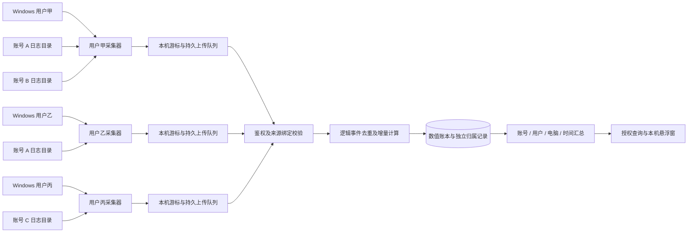

# 多 Windows 用户与多 Codex 账号统计设计

日期：2026-10-26。本文保留原始目标设计。后续用户明确“不限定哪些 Windows 用户可以使用哪些 Codex 账号”，实际实现采用自动发现和连续观察归属，未引入账号使用名单。客户端 0.4.0、服务器 0.2.0、数据库版本 2 已接入，具体支持范围、限制、安装与验收见 [当前实施说明](MULTI-ACCOUNT-OPERATIONS.md)。下文未全部实施的历史修订和更细证据模型仍是后续设计，不能作为当前能力承诺。

## 需求范围

| 场景 | 采集器要求 | 服务器要求 |
|---|---|---|
| 多个 Windows 登录用户使用同一个 Codex 账号 | 每个用户分别采集自己的日志，绑定同一 Codex 账号；本机视图可经服务器授权查询跨用户汇总 | 合并同一账号用量，保留 Windows 用户和电脑明细，同一逻辑事件只计一次 |
| 同一个 Windows 用户使用多个 Codex 账号 | 支持多个账号配置、独立数据目录与采集进度；共用目录切换必须保留归属边界 | 分账号汇总，并支持该 Windows 用户跨账号合计 |
| 多个 Windows 用户各自使用 Codex | 各自独立运行采集器和保存凭据；不同用户可能使用不同或相同的 Codex 账号 | 按账号、Windows 用户、电脑及其组合筛选，支持授权范围内的总计 |

Codex 账号是用量归属，Windows 用户是使用主体，电脑是运行地点，采集实例是观测和上报来源。它们是独立维度，不能互相替代。Windows 用户不等同于现实中的个人；同名用户也不能自动认定为同一主体。

## 当前实现与缺口

现有 `tenant_id` 提供数据安全隔离，`device_id` 标识上报实例；服务端可以按租户和现有设备归属查询。客户端只加载一套遥测配置及账本；支持扫描多个日志目录，但不会为目录识别账号。当前协议、数值适配器与账本均没有 Codex 账号或 Windows 用户归属字段。只改变配置名称或界面标签不能实现准确分账。

原有 `owner_device_id` 是逻辑流注册归属，`received_device_id` 是上传来源，两者都不足以证明每一笔用量实际由哪个 Windows 用户产生。必须单独建立用量归属与来源证据。

## 目标结构

### 身份与权限

在现有租户内建立这些实体，保留租户作为安全边界：

| 字段 | 含义与生成原则 |
|---|---|
| `account_id` | 服务端分配的 Codex 账号内部 UUID。同一账号在不同 Windows 用户、电脑上绑定同一 ID，不使用显示名或邮箱直接判重 |
| `machine_id` | 注册的电脑 ID，区别于采集实例；不上传硬件序列号。跨用户安装由注册流程确认同一电脑，不能仅凭同名电脑自动合并 |
| `principal_id` | Windows 用户在该电脑上的内部 ID；本机 SID 只用于本地匹配，原始 SID、用户名和用户目录不作为默认上报字段 |
| `agent_id` | 采集实例 ID。每个 Windows 用户的安装独立注册、独立上传凭据；现有设备模型需要兼容映射 |
| `source_binding_id` | 某采集实例下的数据目录与账号的绑定版本；目录路径仅在本机保存 |
| `stream_id / event_id` | 逻辑会话和检查点的稳定匿名身份；同一日志副本保持一致 |

账号注册默认采用管理员创建的内部账号 ID 和本机明确绑定。自动识别只在核对稳定的官方身份来源后增加适配器，不依赖未验证的登录文件格式，不解析或上传访问令牌。显示别名只用于界面，不承担身份认证或授权作用。

服务端以上传凭据确定租户、采集实例及其允许使用的绑定，不能相信请求中任意填写的账号或 Windows 用户。管理入口授权账号绑定；普通上传凭据不具有为其他用户建绑定或跨范围读统计的权限。跨用户、跨账号总览使用独立授权查询范围；服务器不会向任何客户端开放所有租户的数据。

### 采集部署方式

每个 Windows 用户运行自己的采集器，只读本用户已绑定的数据目录。凭据用该用户 DPAPI 加密，账本、锁、状态、暂停开关和启动入口置于各用户独立的应用数据目录，避免目前项目下固定 `.local/client` 在多人使用时发生文件冲突。程序文件可以共用，运行状态不能共用。

采集器不以管理员身份遍历所有用户的登录资料。一个用户的本机跨用户汇总通过服务器返回授权数值，不要求读取其他用户目录。尚未登录启动、已经注销或离线的采集器不能实时上报；服务器应显示来源在线情况与覆盖状态，重新运行后按持久游标补传。需要无人登录时继续采集，应另行实现和验证服务部署模式。

同一 Windows 用户的每个账号配置包含：内部账号 ID、显示别名、日志目录、本地绑定 ID、独立游标命名空间和读取额度的执行环境。优先使用独立数据目录。账号切换后，不能仅修改同一个账本的身份密钥或把旧检查点重新建立为新账号的总量。

额度查询需要显式绑定对应账号的执行环境，不能把当前单一环境的查询结果复制到所有账号。无法验证当前身份或读取额度时显示未知；不能通过重新登录轮询账号。额度继续按现有原则仅本机保存和显示，不因本次多账号数值统计需求自动上传服务器。

### 账号和用户归属

每笔派生增量分别关联账号与执行主体，并保存 `attribution_status` 和证据类型。状态建议为 `confirmed`、`unknown`、`conflict`。可以已确认账号、但执行 Windows 用户未知，不能因此丢弃该笔用量。

1. 独立账号目录的绑定从确认后的捕获边界开始生效，不自动覆盖目录中既有历史。
2. 共用目录发生账号切换时，持久记录检查点或明确任务边界，并按增量归属，不把会话完整累计值改归新账号。
3. 如果一个增量区间跨越切换且缺少可信中间检查点，不按时间比例估算；该区间进入未归属，并显示原因。
4. 多个账号并发使用同一目录时，单纯的“当前登录账号”和切换时间不足以确定归属。没有逐会话或逐请求可靠证据时保持未知，并提示使用独立目录。
5. 离线补传使用事件产生时已经持久化的绑定，不按上传时的登录状态重新分配。
6. 共享账号由不同 Windows 用户使用，`account_id` 相同，执行主体不同；账号视图合并，用户视图保留各自增量。
7. 初次导入的旧数据默认未归属；只有可验证的历史证据才允许归属修订，不能一键认领为当前账号。

本机活跃会话的 `threads.tokens_used` 是整段会话累计，不能直接作为多账号分账依据。若同一会话跨账号使用，界面应展示“整段会话累计”和“已确认账号分段用量”，无法拆分部分标记未归属，不能把整段会话数字展示成当前账号用量。

### 去重和归属是两个步骤

同一份日志可能被复制、同步或由多个用户观察。用于全局去重的逻辑事件键不能加入上传者、Windows 用户、目录或账号标签，否则复制后会产生新的事件身份、重复累计。跨实例沿用已验证的稳定身份、共同基线和顺序恢复规则；不同密钥无法建立相同身份时应明确来源冲突，不能假定已经去重。

原始数值事件不可变，来源观测单独记录：谁上报了哪份逻辑事件。派生增量只产生一份；归属修订在审计表中追加版本，汇总采用当前有效归属。另一个用户上传副本不能改变已确认执行主体；证据冲突时保留一份数值并标记冲突。日志只证明观测来源而未证明实际执行主体时，用户归属保持未知。

用户视图按执行主体聚合，另设来源状态视图统计采集器在线与上传情况。不能把最先上传者当作实际执行者，也不能对采集器各自完整累计直接求和。

### 服务端模型与接口调整

新增账号、电脑、Windows 主体、来源绑定和授权关系表。数值流、事件、去重键保持逻辑身份语义；新增增量归属及修订审计表、事件来源观测表。归属记录与增量通过现有 `(tenant_id, stream_id, epoch, source_seq)` 关联，唯一的当前归属保证同一增量只归到一个账号和一个执行主体（允许未知）。所有关联包含租户，防止跨租户绑定。

协议升级需要增加绑定引用与归属证据的白名单字段，更新规范化与语义冲突判定规则；不能直接向现有严格协议塞入字段。客户端数据缓存、隐私说明、数据库迁移和服务角色权限同时升级。服务器验证绑定与凭据后再关联归属。

查询在现有四周期语义上增加账号、电脑、Windows 主体筛选和相应分组。所有筛选取交集；返回统计范围、归属质量、来源覆盖质量和查询时刻。账号列表与绑定管理接口独立鉴权。未知和冲突必须有可见分组，总计保留它们；同一维度的互斥分组之和应等于该范围总计。

当前仅有租户及设备归属的数据迁移为“账号/执行主体未归属”，保留既有累计和原始接收来源，不从当前登录状态或设备归属推断历史执行用户。新旧客户端并存时，旧客户端继续进入兼容的未归属路径；界面不得把旧数据静默漏掉。

## 界面与统计口径

本机悬浮窗可切换本 Windows 用户下的账号，以及经过授权的本机跨用户账号总览。明确标注当前范围，例如“本用户 · 账号 A”或“本机全部用户 · 账号 A”。周期卡片、活跃会话列表必须使用同一选择范围；某范围的远端活跃会话详情若没有上报能力，应明确显示仅本机当前用户的活跃会话，不伪装为全范围列表。

账号 A 在两个 Windows 用户下使用时，官方剩余额度属于账号 A 的额度视图，不将两个用户读到的剩余百分比相加。不同账号的额度分别展示。Token 总量仍按输入加输出，不重复加入缓存输入或推理输出子集。

本次设计不要求上传标题、对话、原始会话 UUID、路径、邮箱或登录令牌。服务器新增的仅是内部身份和绑定引用、数值归属与必要状态。已存在的本机活跃标题显示仍保持本机范围。若后续需要跨用户显示远端会话标题，应独立明确需求和授权。

## 验收示例

假设同一统计周期内有四笔不同的真实增量：

| Windows 用户 | Codex 账号 | Token |
|---|---|---:|
| 甲 | A | 100 |
| 乙 | A | 200 |
| 甲 | B | 50 |
| 丙 | C | 80 |

账号结果应为 A=300、B=50、C=80；Windows 用户结果应为甲=150、乙=200、丙=80，总计均为 430。甲的 A 日志被乙再次上传后仍是 430，不改变执行用户归属。若有无法确认账号的 20 Token，总计为 450，并单列未归属 20，不能擅自归到 A、B 或 C。

测试还必须覆盖：同名 Windows 用户、同机不同 SID、共享账号跨用户、单用户多账号、并发目录、会话跨账号切换、切换区间缺少检查点、账号切换后的离线补传、日志副本与不同采集顺序、异常重启、未知历史迁移、跨范围越权、额度身份不匹配。至少使用两个实际 Windows 用户完成登录、启动、暂停互不影响和重启后的联调；当前单用户模拟不能替代该验收。

## 实施顺序

1. 实现每用户独立运行状态和账号配置模型，保留现有 0.3.0 数据，不自动重标历史。
2. 增加服务器身份注册、授权绑定、归属及审计迁移，验证旧版兼容和防越权。
3. 升级本地账本、绑定边界与上传协议，先验证独立目录，再支持有可靠边界的共用目录。
4. 增加查询筛选、窗口范围选择及账号隔离的额度读取。
5. 合成测试和隔离环境联调通过后，备份生产数据，再部署迁移；以真实多用户完成验收。

实际接入需要列明 Windows 用户与 Codex 账号对应关系、各账号日志目录，以及授权查询范围。无需提供密码或访问令牌；缺少这些映射时可以开发功能和合成验证，但不能声称已完成真实账号分账。
