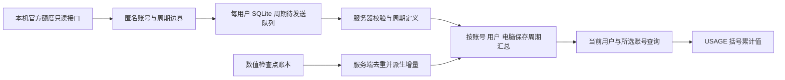

# 额度重置周期统计（客户端 0.6.0 / 服务端 0.3.0）

2026-10-26，数据库版本 3，已部署并接入本机实际数据。

## 显示与统计口径

窗口标题为 **Codex**，账号头像与明文姓名居中，保留下拉切换。USAGE 两项标签采用 `5 小时额度（当期累计 Token）`、`每周额度（当期累计 Token）`；剩余比例、进度条和重置倒计时继续显示。

括号数字只包含**当前 Windows 用户、所选 Codex 账号、该次额度周期**已确认采集并上传的输入加输出 Token。缓存输入和推理输出是子集，不重复相加。鼠标停在标签上可查看准确起止时间、分项和更新时间。未知或待查询显示“—”，已确认零用量显示 0。

额度周期与上方四张卡的统计口径不同：上方是最近 5 小时及北京时间自然日、周、月；额度区域按官方返回的重置时间和周期长度确定本次周期。起点以 `重置时间 − 周期长度` 推定，不根据本机启动时间生成，也不把 Token 换算为额度百分比。启用前历史、未知归属与未适配日志均不补造，因此标记部分覆盖。

## 数据流与持久化

客户端上传的周期元数据只有匿名账号键、primary/secondary 桶、周期分钟数、重置时刻及观察时间。剩余百分比、头像、明文姓名和 Codex 登录凭据不上传。数值增量继续使用原独立遥测凭据。仅观察到的真实周期建立记录，离线跨过的未知周期不凭空生成。

服务端新增 `quota_cycles`（定义与有效边界）、`quota_cycle_observations`（设备观察记录）、`quota_cycle_totals`（按 Windows 用户和电脑保存分项累计）。数值入库与受影响周期汇总更新位于同一事务；重复重传不重复计数，晚到的有效事件会补算历史周期。

统计区间为 `[起点, 有效终点)`。提前观察到新周期时，旧周期有效终点收缩到新周期起点，保留原计划重置时刻供核查，避免同一额度桶重复覆盖。相同周期的定义冲突返回 409，客户端隔离该条元数据并提示核对，其余周期和数值上传继续处理。

周期报告每约 60 秒刷新，独立工作线程约每 10 秒查询当前显示账号；联网不阻塞日志采集。超过 35 秒的查询缓存变暗并提示刷新。已结束周期的旧累计不会冒充新周期数据。周期和本地资料分别保存，明文资料仅在当前 Windows 用户私有目录。

## 查询和维护

- `POST /v2/usage/quota-cycles`：设备 write 凭据，严格白名单周期元数据。
- `GET /v2/usage/quota-cycles?account=<匿名账号键>&principal=<匿名用户键>`：read 凭据，受其作用域约束；可按账号查询跨用户总量，受限凭据仍只读取自身范围。
- PowerShell 查询：`deploy/Query-Usage.ps1 -QuotaCycles -Account <完整匿名账号键> -WindowsUser <匿名用户键>`，返回 JSON。省略 WindowsUser 的权限范围取决于凭据。

升级前备份为服务器 `backups/pre-upgrade-0.3.0.dump` 及校验文件，源码备份为 `private/pre-upgrade-0.3.0-source.tar.gz`。数据库 v2 备份已在独立临时库恢复并迁移到 v3，两次迁移均成功，223 条原始事件及全部既有数值保持一致。生产数据库没有写入合成用量。

## 验证记录与边界

- 真实 PostgreSQL 独立测试库：34 项通过，9.353 秒；覆盖重置边界、晚到补传、提前重置、重复、冲突、权限撤销、共享账号及并发周期登记/入库。
- 客户端 Python：70 项通过；账号显示 15 项、额度显示 14 项、周期显示 11 项检查通过。
- 本机实际窗口已核对标题、居中账号和括号累计值，完整大整数可见。
- 2026-10-26 03:23:13（北京时间）暂停并清空发送队列后，237 个已确认检查点推导的本用户/本账号两个实际周期均为 24,722,153；输入、缓存输入、输出、推理输出、总量与服务器逐项一致。核对完成后已恢复采集。

实际联调仍为一个 Windows 用户和一个 Codex 账号；多个真实 Windows 登录与多个真实账号切换尚未实机验收。重置切换通过合成测试验证，未为测试主动消耗或重置官方额度。
